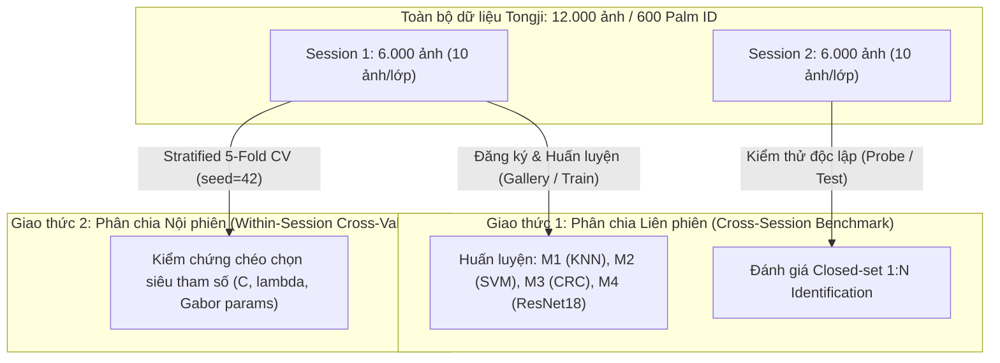

# Dữ liệu và Mô tả Dữ liệu (Dataset Documentation)

> **Môn học**: Nhận dạng mẫu (*Pattern Recognition*)  
> **Đề tài 09**: Nhận diện lòng bàn tay không tiếp xúc (*Contactless Palmprint Recognition*) — **Nhóm 01**  
> **Sản phẩm nộp**: Mục 3 theo yêu cầu đề bài (*Dữ liệu và mô tả dữ liệu: nguồn dữ liệu, cách xử lý và cách phân chia tập dữ liệu*).

---

## 1. Nguồn Dữ liệu & Hướng dẫn Cài đặt (Data Source & Download)

### 1.1. Nguồn gốc bộ dữ liệu hợp lệ
Bộ dữ liệu được sử dụng là **Tongji Contactless Palmprint Dataset** do nhóm tác giả Lin Zhang et al. tại **Đại học Đồng Tế (Tongji University)** công bố năm 2017:
* **Công trình gốc**: *"Towards Contactless Palmprint Recognition: A Novel Device, A New Benchmark, and A Collaborative Representation Based Identification Approach"* (IEEE Transactions on Information Forensics and Security, 2017).
* **Liên kết chính thức từ tác giả**: [https://cslinzhang.github.io/ContactlessPalm/](https://cslinzhang.github.io/ContactlessPalm/)

### 1.2. Quy định lưu trữ dữ liệu lớn (Không nộp kèm tập ảnh nặng)
* Theo hướng dẫn của đề tài, các file ảnh gốc/ảnh ROI có dung lượng lớn được **loại khỏi Git tracking** thông qua file `.gitignore` để tránh phình to kích thước repository.
* Để kiểm tra và tái lập kết quả, người đánh giá tải bộ dữ liệu từ liên kết tác giả ở trên và giải nén theo cấu trúc:
  ```text
  data/
  └── raw/
      ├── session1/          # 6.000 ảnh ROI (00001.bmp -> 06000.bmp)
      └── session2/          # 6.000 ảnh ROI (00001.bmp -> 06000.bmp)
  ```
* Hệ thống đi kèm cơ chế kiểm tra tự động mã băm SHA-256 đối chiếu với file [`data/metadata/manifest.csv`](file:///D:/Nhandienmau/DA/data/metadata/manifest.csv) để đảm bảo dữ liệu giải nén hoàn toàn nguyên bản.

---

## 2. Mô tả Chi tiết Bộ Dữ liệu (Dataset Description)

### 2.1. Đối tượng và Nhân khẩu học mẫu
* **Đối tượng nhận dạng**: Hoa văn nếp vân lòng bàn tay (*palmprint features*: nếp vân chính, nếp nhăn phụ vi mô) của con người thu nhận ở chế độ không tiếp xúc.
* **Quy mô thu thập**:
  * **300 tình nguyện viên** (192 nam, 108 nữ, độ tuổi từ 17 đến 57 tuổi).
  * Mỗi người cung cấp ảnh của cả **2 bàn tay** (tay trái và tay phải).
  * Tổng cộng: **600 Palm ID** độc lập (tương ứng 600 lớp phân loại).
* **Số lượng ảnh**:
  * Mỗi bàn tay được chụp **10 ảnh/phiên**, thực hiện qua **2 phiên độc lập (Session 1 và Session 2)**.
  * Tổng số mẫu: $600 \times 10 \times 2 = \mathbf{12.000\text{ ảnh}}$.
* **Tính cân bằng lớp**: **Cân bằng hoàn hảo 100%** (mọi lớp đều có chính xác 10 ảnh trong Session 1 và 10 ảnh trong Session 2, không xảy ra hiện tượng mất cân bằng lớp - imbalanced data).

### 2.2. Quy cách kỹ thuật ảnh
* **Ảnh đầu vào của mô hình**: Bộ ảnh vùng quan tâm chuẩn (**Official ROI** do tác giả cung cấp).
* **Kích thước**: $128 \times 128$ pixel.
* **Định dạng & Không gian màu**: Mức xám 8-bit (Grayscale, dải giá trị $[0, 255]$), định dạng `.bmp`.

### 2.3. Thống kê định lượng chất lượng ảnh (Image Quality Audit)
Chất lượng ảnh được đo lường tự động trên toàn bộ 12.000 ảnh (lưu tại [`data/metadata/audit.json`](file:///D:/Nhandienmau/DA/data/metadata/audit.json)):

| Chỉ số chất lượng | Công thức / Định nghĩa | Session 1 (Gallery) | Session 2 (Probe) |
| :--- | :--- | :---: | :---: |
| **Cường độ sáng (Brightness)** | $\mu = \frac{1}{N}\sum I_i$ | $131.50 \pm 26.35$ | $132.59 \pm 22.40$ |
| **Độ tương phản (Contrast)** | $\sigma = \sqrt{\frac{1}{N}\sum (I_i - \mu)^2}$ | $17.65 \pm 5.08$ | $17.80 \pm 4.41$ |
| **Độ sắc nét nếp vân (Blur Proxy)** | Phương sai Laplace $\text{Var}(\nabla^2 I)$ | $27.58 \pm 14.05$ | $27.79 \pm 12.94$ |

*Nhận xét*: Hệ thống chiếu sáng LED vòng của thiết bị chụp Tongji cho cường độ sáng và độ tương phản ổn định cao giữa 2 phiên, không bị suy giảm chất lượng toàn cục.

---

## 3. Cách Xử lý & Biểu diễn Dữ liệu (Preprocessing & Feature Extraction)

### 3.1. Trích xuất ROI từ ảnh bàn tay gốc (Hand Segmentation & Custom ROI Extractor)
Dự án hỗ trợ cả hai phương thức xử lý ROI:
1. **Official ROI (Khuyên dùng cho toàn bộ Benchmark)**: Bộ ảnh $128 \times 128$ do nhóm tác giả Lin Zhang chuẩn hóa sẵn, đảm bảo công bằng khi huấn luyện và đánh giá trên toàn bộ 600 Palm ID (12.000 ảnh).
2. **Custom ROI Extractor (Tự triển khai độc lập)**: Mã nguồn tại [`src/palmprint/data/tongji_roi.py`](file:///D:/Nhandienmau/DA/src/palmprint/data/tongji_roi.py) cài đặt trực tiếp thuật toán trích xuất ROI hình học từ ảnh bàn tay gốc $800 \times 600$ theo Mục 4 bài báo Zhang et al. 2017:
   - **Phân đoạn bàn tay**: Lọc Gaussian (`sigma=1.5`) và nhị phân hóa ngưỡng thích ứng tạo mặt nạ lòng bàn tay (`hand_mask`).
   - **Dò 3 điểm kẽ ngón tay**: Tính góc quay vi phân của đường biên để định vị 3 kẽ ngón tay (kẽ trỏ–giữa, giữa–áp út, áp út–út).
   - **Tiếp tuyến chung hỗ trợ**: Tìm tiếp tuyến chung dưới (`common_tangent`) qua hai kẽ ngón ngoài với bán kính lân cận `radius = tangent_patch_fraction * separation`.
   - **Thiết lập hệ tọa độ và Cắt Affine**: Dựng trục tọa độ theo tâm tiếp tuyến, dịch vào lòng bàn tay $0.60 \times |X_1 X_2|$ và trích xuất khung ảnh $128 \times 128$ qua phép biến đổi affine (`cv2.warpAffine`).
   - **Kiểm chứng thực nghiệm**: Báo cáo tại [`reports/ROI_COMPARISON.md`](file:///D:/Nhandienmau/DA/reports/ROI_COMPARISON.md) trên 200 ảnh (10 Palm ID) cho thấy tỷ lệ cắt thành công đạt **99.5% (199/200 ảnh)** và độ chính xác nhận dạng Rank-1 đạt **98.00%** (so với 99.00% của Official ROI).

### 3.2. Tiền xử lý & Trích xuất đặc trưng trong mã nguồn
Trong mã nguồn [`src/palmprint/`](file:///D:/Nhandienmau/DA/src/palmprint):
1. **Chuẩn hóa đầu vào (Input Pipeline)**:
   - Hàm [`read_gray()`](file:///D:/Nhandienmau/DA/src/palmprint/data/dataset.py#L32) đọc trực tiếp từ bộ đệm byte NumPy (tương thích đường dẫn Unicode trên Windows), ép kiểu 8-bit và kiểm soát nghiêm ngặt kích thước $128 \times 128$.
2. **Bộ lọc Gabor cạnh tranh (CompCode - Competitive Coding)**:
   - Tạo ngân hàng 6 bộ lọc Gabor giải tích với hướng $\theta \in \{0, \frac{\pi}{6}, \frac{2\pi}{6}, \dots, \frac{5\pi}{6}\}$.
   - **Khử thành phần DC (`zero_dc=True`)**: Trừ giá trị trung bình khỏi kernel (`kernel -= kernel.mean()`) giúp triệt tiêu hoàn toàn ảnh hưởng của biến thiên độ sáng toàn cục ($\Delta = 0.00$ pp khi thay đổi độ sáng $\pm 15$).
   - Thi đấu phản hồi thung lũng vân ($\arg\min$).
   - Phân hoạch lưới $10 \times 10$ khối, tính biểu đồ tần suất hướng (Histogram) và chuẩn hóa 2 cấp $L_1 \to L_2$, tạo vector đặc trưng 600 chiều.
3. **Mạng học sâu không giám sát (M5 — PalmNet Gabor-PCA)**:
   - Học ngân hàng bộ lọc tích chập Gabor-PCA 2 tầng từ dữ liệu Session 1 ([`reports/PALMNET_M5.md`](file:///D:/Nhandienmau/DA/reports/PALMNET_M5.md)).

---

## 4. Giao thức Phân chia Tập Dữ liệu (Dataset Splitting Protocol)

Nhóm áp dụng hai quy thức phân chia dữ liệu khoa học, độc lập và chặt chẽ:



### 4.1. Giao thức Đánh giá Liên phiên (Cross-Session Benchmark — Closed-set 1:N)
* **Tập Huấn luyện / Đăng ký (Gallery / Train Set)**:
  * Toàn bộ **Session 1** gồm **6.000 ảnh** (10 ảnh cho mỗi Palm ID trong số 600 lớp).
  * Được dùng để: Xây dựng từ điển tái tạo $A \in \mathbb{R}^{600 \times 6000}$ của CRC_RLS; huấn luyện siêu phẳng Linear SVM; tạo 6.000 template mẫu cho 1-NN; trích xuất 600 vector trọng tâm Centroid; và huấn luyện mạng ResNet18.
* **Tập Kiểm thử (Probe / Test Set)**:
  * Toàn bộ **Session 2** gồm **6.000 ảnh** (10 ảnh cho mỗi Palm ID).
  * Session 2 được thu sau Session 1 khoảng **vài tuần đến 2 tháng** (trung bình ~61 ngày).
  * Mục tiêu: Đánh giá độ chịu đựng của mô hình trước các biến dạng thực tế theo thời gian (*Session Drift*): xoay lệch tự do ($\pm 5^\circ - 10^\circ$), co giãn bề mặt da và co ngón tay.

### 4.2. Giao thức Đánh giá Nội phiên (Within-Session 5-Fold Cross-Validation)
* Áp dụng trên 6.000 ảnh của Session 1.
* Chia đều mỗi Palm ID thành 5 phần (mỗi phần 2 ảnh/Palm ID, tổng 1.200 ảnh/fold).
* Được cố định hạt giống ngẫu nhiên (`seed: 42`) và lưu trường `fold` (0 đến 4) trong file [`data/metadata/manifest.csv`](file:///D:/Nhandienmau/DA/data/metadata/manifest.csv).
* Mục tiêu: Tinh chỉnh siêu tham số ($\lambda$ của CRC, $C$ của SVM, kích thước khối CompCode) mà tuyệt đối **không rò rỉ thông tin từ tập kiểm thử Session 2 (Zero Data Leakage)**.

---

## 5. Danh mục Metadata và File Kiểm định Đi Kèm

Mọi thông tin về tập dữ liệu được lưu trữ có cấu trúc trong thư mục [`data/metadata/`](file:///D:/Nhandienmau/DA/data/metadata):
1. **[`data/metadata/manifest.csv`](file:///D:/Nhandienmau/DA/data/metadata/manifest.csv)**: Danh mục 12.000 dòng ghi nhận chi tiết: `sample_uid`, `session`, `palm_id`, `path`, kích thước, mã băm `sha256`, chỉ số chất lượng ảnh (`brightness`, `contrast`, `blur_proxy`) và `fold`.
2. **[`data/metadata/audit.json`](file:///D:/Nhandienmau/DA/data/metadata/audit.json)**: Báo cáo kiểm định tự động xác nhận số lượng ảnh (12.000), số lớp (600), số nhóm trùng lặp (0 nhóm), và các phân bố chất lượng.
3. **[`data/metadata/local_dataset.json`](file:///D:/Nhandienmau/DA/data/metadata/local_dataset.json)**: Khóa đồng bộ đường dẫn và kiểm tra mã băm manifest trên máy cục bộ.
4. **[`reports/EDA.md`](file:///D:/Nhandienmau/DA/reports/EDA.md)** & **[`notebooks/01_eda.ipynb`](file:///D:/Nhandienmau/DA/notebooks/01_eda.ipynb)**: Báo cáo phân tích khám phá dữ liệu (EDA) và trực quan hóa chi tiết.
