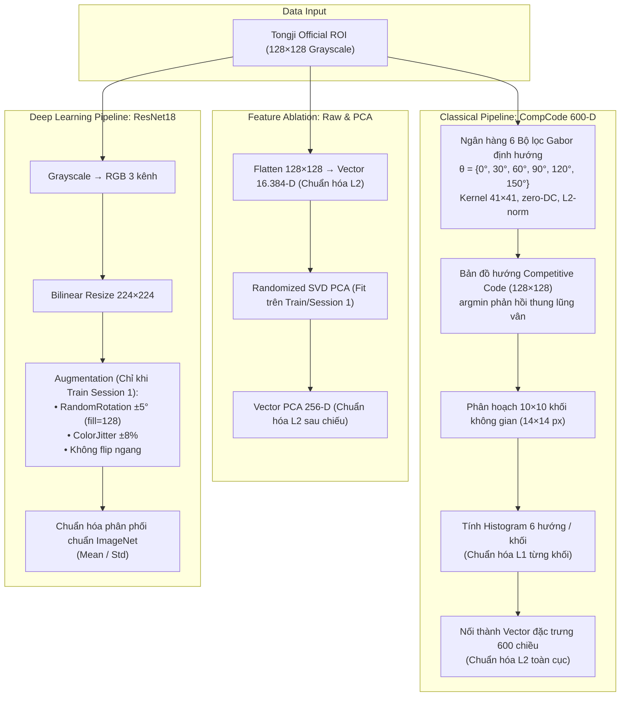

# Tongji Contactless Palmprint Recognition

> **BÀI TẬP LỚN CUỐI KỲ — MÔN NHẬN DẠNG MẪU (PATTERN RECOGNITION)**  
> **Đề tài số 9:** Nhận diện lòng bàn tay không tiếp xúc (*Contactless Palmprint Recognition*)  
> **Nhóm thực hiện:** Nhóm 01  
> **Repository:** [https://github.com/hloc1810/tongji-palmprint-recognition](https://github.com/hloc1810/tongji-palmprint-recognition)

---

## 1. Giới thiệu bài toán & Dữ liệu

Hệ thống nhận dạng sinh trắc học lòng bàn tay không tiếp xúc (*Contactless Palmprint Identification*) theo giao thức **closed-set 1:N** trên bộ dữ liệu chuẩn **Tongji Contactless Palmprint Dataset**:
- **Đối tượng nhận dạng**: **600 Palm ID** (mỗi bàn tay là một lớp độc lập, tương ứng 300 tình nguyện viên $\times$ 2 bàn tay trái/phải).
- **Quy mô dữ liệu**: 12.000 ảnh Official ROI kích thước $128 \times 128$ (ảnh mức xám 8-bit).
- **Giao thức phân chia phiên (Cross-Session Protocol)**:
  - **Session 1 (Gallery / Huấn luyện)**: 6.000 ảnh (10 ảnh/Palm ID $\times$ 600 lớp).
  - **Session 2 (Probe / Kiểm thử)**: 6.000 ảnh (10 ảnh/Palm ID $\times$ 600 lớp), được thu nhận cách Session 1 từ vài tuần đến hơn một tháng nhằm mô phỏng điều kiện thực tế (thay đổi độ sáng, xoay góc bàn tay, biến dạng co giãn da).
- **Nguyên tắc chống rò rỉ dữ liệu (Zero Data Leakage)**:
  - Toàn bộ siêu tham số được tối ưu thông qua **5-fold Cross-Validation nội bộ trên Session 1** (`seed=42`).
  - Khóa cấu hình mô hình (`artifacts/protocol_lock.json`) trước khi thực hiện bất kỳ phép đo nào trên Session 2.
  - Không sử dụng dữ liệu Session 2 để chọn tham số, chọn seed hay hiệu chỉnh tiền xử lý.

---

## 2. Kết quả thực nghiệm chính thức (Benchmark)

Thực nghiệm đo đạc độc lập trên **6.000 probe Session 2** đối chiếu với **6.000 gallery Session 1**:

| Pipeline | Mô hình nhận dạng | Rank-1 (%) | Rank-5 (%) | Macro-F1 (%) | Độ trễ CPU (ms/ảnh) |
|---|---|---:|---:|---:|---:|
| **M3** | **CompCode + CRC_RLS** ($\lambda=0.1$, unnormalized residual) | **98.27%** | **99.08%** | **97.99%** | 14.71 ms |
| **M2** | **CompCode + Linear SVM OvR** ($C=1$, squared-hinge) | **97.37%** | **98.52%** | **96.82%** | **3.71 ms** |
| **M1** | **CompCode + 1-NN** ($k=1$, Euclidean²) | **94.43%** | **96.97%** | **93.56%** | 11.00 ms |
| **M4-E2** | **ResNet18 Nearest Cosine** (512-D, 10 template/lớp) | **73.74% ± 0.62** | **87.50% ± 0.44** | **70.51% ± 0.81** | ~19.34 ms |
| **M4-E2** | **ResNet18 Centroid Cosine** (512-D, 1 tâm/lớp) | **68.83% ± 0.76** | **83.70% ± 0.63** | **65.37% ± 0.82** | ~19.34 ms |
| **M4-E1** | **ResNet18 Logits** (Softmax 600 lớp) | **64.36% ± 1.04** | **81.91% ± 0.65** | **60.79% ± 1.10** | ~48.72 ms |

*Ghi chú*: Kết quả ResNet18 là trung bình và độ lệch chuẩn mẫu qua 3 seed độc lập (17, 29, 43). Độ trễ đo trên CPU AMD Ryzen 7 5800H chạy đơn luồng (bao gồm đọc ROI, trích đặc trưng và tính điểm 600 lớp).

### Phân tích khoa học nổi bật:
1. **CRC_RLS (M3) đạt hiệu năng cao nhất (98.27%)**: Nhờ cơ chế biểu diễn cộng tác (*collaborative representation*), toàn bộ 6.000 mẫu trong gallery cùng tham gia tái tạo mẫu truy vấn thông qua hồi quy Ridge có điều chuẩn $L_2$, giúp triệt tiêu sai lệch ánh sáng và góc chụp giữa 2 phiên hiệu quả nhất.
2. **Linear SVM (M2) đạt tốc độ nhanh nhất (3.71 ms/ảnh)**: Trong pha suy luận, SVM One-vs-Rest chỉ thực hiện 1 phép nhân ma trận trọng số $W \in \mathbb{R}^{600 \times 600}$ với vector đặc trưng 600-D, nhanh gấp 4 lần CRC và 13 lần ResNet18 mà vẫn đạt Rank-1 rất cao (97.37%).
3. **Đánh giá hậu nghiệm với Cosine Embedding (+9.38 điểm % Rank-1)**:
   - ResNet18 được huấn luyện bằng hàm mất mát phân loại (*Cross-Entropy loss* trên 600 lớp Session 1), **đây là phương pháp embedding-based matching, chưa phải huấn luyện bằng metric learning chuyên biệt (như contrastive loss hay triplet loss)**.
   - Thử nghiệm trích xuất vector đặc trưng 512-D và so khớp khoảng cách Cosine (M4-E2) là **thực nghiệm hậu nghiệm (post-hoc / exploratory)** được thực hiện sau khi đã quan sát kết quả Session 2.
   - Do đó, mức tăng +9.38 điểm phần trăm Rank-1 so với Softmax logits mang **giá trị mô tả (descriptive)** về tiềm năng của không gian biểu diễn đặc trưng, nhưng **chưa phải là bằng chứng xác nhận (confirmatory)** trên một tập kiểm thử độc lập thứ ba.

---

## 3. Thực nghiệm bóc tách đặc trưng (Feature Representation Ablation — E3)

Để trả lời câu hỏi nghiên cứu: *"Trong giao thức nhận dạng cross-session trên Tongji, biểu diễn nào cho phép 1-NN phân biệt các Palm ID hiệu quả hơn?"*, nhóm tiến hành thực nghiệm đối chiếu 3 phương pháp biểu diễn đặc trưng, cố định duy nhất bộ phân loại là **1-Nearest Neighbor (k=1, Euclidean)**:
1. **F1 — Raw Grayscale Pixels**: Vector ảnh xám $128 \times 128$ làm phẳng (16.384 chiều), chuẩn hóa $L_2$.
2. **F2 — PCA (Principal Component Analysis)**: Giảm chiều xuống 256 chiều bằng Randomized SVD (seed=42). Tuân thủ nghiêm ngặt **zero-leakage** (chỉ fit trên tập train của từng fold trong CV; chỉ fit trên toàn bộ Session 1 trong kiểm thử cross-session), chuẩn hóa $L_2$ sau chiếu. 256 thành phần chính giải thích **93.77%** tổng phương sai của Session 1.
3. **F3 — CompCode**: Vector đặc trưng 600 chiều từ ngân hàng 6 bộ lọc Gabor 2D, mã hóa thi đấu hướng vân và spatial block histogram ($10 \times 10$ ô).

### Bảng kết quả thực nghiệm bóc tách:

| Biểu diễn Đặc trưng | Số chiều | Session 1: 5-Fold CV Rank-1 (%) | Session 2: Cross-Session Rank-1 (%) | Rank-1 95% CI (Session 2) | Cross-Session Rank-5 (%) | Macro-F1 (Session 2) | Độ sụt giảm (Generalization Gap) | Thời gian khớp (ms/mẫu) |
| :--- | :---: | :---: | :---: | :---: | :---: | :---: | :---: | :---: |
| **F1 — Raw Grayscale** | 16.384 | 99.40 ± 0.41% | **77.18%** | [74.67%, 79.53%] | 85.65% | 75.64% | **-22.22%** | 0.61 ms |
| **F2 — PCA** | 256 | 99.43 ± 0.31% | **76.72%** | [74.23%, 79.07%] | 84.75% | 74.67% | **-22.71%** | **0.09 ms** |
| **F3 — CompCode** | 600 | 99.98 ± 0.04% | **94.43%** | [93.02%, 95.68%] | **96.97%** | **93.56%** | **-5.55%** | 0.11 ms |

### Nhận xét và Phân tích khoa học:
- **Hiện tượng "Bẫy kiểm định chéo" (Within-Session CV Trap)**: Trong cùng Session 1, cả Raw Pixels và PCA đều đạt Rank-1 $>99.4\%$. Nếu chỉ kiểm định nội phiên, người nghiên cứu dễ lầm tưởng rằng không cần trích xuất đặc trưng phức tạp.
- **Sự sụp đổ của Raw Pixels và PCA ở Cross-Session (-22%)**:
  - *Raw Pixels*: Khoảng cách Euclidean $d^2(x, y) = \sum (x_i - y_i)^2$ rất nhạy cảm với dịch chuyển không gian (spatial shift). Sự thay đổi nhẹ về góc đặt tay và cường độ sáng giữa hai phiên làm toàn bộ lưới pixel bị trôi, khiến khoảng cách cùng lớp vượt khoảng cách khác lớp.
  - *PCA*: Theo giáo trình Duda (*Pattern Classification*), PCA tìm các trục có phương sai toàn cục lớn nhất. Trên ảnh bàn tay, các trục này đại diện cho sự biến thiên ánh sáng nền và hình thái tổng thể, bỏ qua vi cấu trúc đường vân. Khi sang Session 2, sự thay đổi nguồn sáng làm vector chiếu PCA bị sai lệch.
- **Tính ưu việt của CompCode (+17.25% so với Raw, +17.71% so với PCA)**:
  - Bộ lọc Gabor khử thành phần một chiều (Zero-DC: `kernel -= kernel.mean()`), triệt tiêu biến thiên độ sáng nền.
  - Competitive Coding chỉ lấy chỉ số hướng vân nổi trội nhất ($\arg\min$), bất biến với biên độ tương phản.
  - Spatial Block Histogram ($10 \times 10$ ô) tạo dung sai cho phép co giãn da tự nhiên và dịch chuyển cục bộ mà không làm mất thông tin nhận dạng.

---

## 4. Phân định: Cài đặt từ đầu (Code tay) vs Thư viện sử dụng

Nhóm phân định ranh giới kỹ thuật rõ ràng giữa các thuật toán lõi được lập trình từ công thức toán học và các thư viện chuẩn công nghiệp:

| Thành phần | Loại cài đặt | Chi tiết "Code tay" (From-Scratch) | Thư viện bên thứ ba sử dụng |
| :--- | :---: | :--- | :--- |
| **Trích xuất đặc trưng CompCode** | **Tự viết 90%** | • Tự tạo ngân hàng 6 bộ lọc Gabor giải tích từ phương trình toán.<br>• Tự khử DC (`kernel -= kernel.mean()`) và chuẩn hóa $L_2$ kernel.<br>• Tự viết competitive coding ($\arg\min$ 6 hướng phản hồi).<br>• Tự chia lưới $10 \times 10$ block, tính spatial histogram và chuẩn hóa 2 cấp ($L_1 \to L_2$). | `cv2.filter2D` (OpenCV: tăng tốc tích chập 2D qua tập lệnh SIMD/AVX2). |
| **Phân lớp Collaborative Ridge (CRC_RLS)** | **Tự viết 85%** | • **Không có sẵn trong scikit-learn!**<br>• Tự xây dựng ma trận từ điển $A$ và ma trận Gram không gian đặc trưng $G = A A^T + \lambda I$.<br>• Tự lập trình giải hệ phương trình hồi quy Ridge.<br>• Tự lập trình công thức tính sai số tái tạo Euclidean từng lớp $\|y - A_c \alpha_c\|_2$. | `scipy.linalg.cho_factor` & `cho_solve` (LAPACK C-level: phân rã Cholesky để đảm bảo ổn định số học). |
| **Phân lớp 1-NN (Nearest-Template)** | **Tự viết 100%** | • Tự viết class `NearestTemplate`.<br>• Tự tính ma trận khoảng cách Euclidean bình phương $\|y-v\|^2 = \|y\|^2 + \|v\|^2 - 2y v^T$.<br>• Tự xếp hạng khoảng cách nhỏ nhất theo từng Palm ID. | Không dùng `sklearn.neighbors` (nhóm tự tính toán ma trận thuần NumPy). |
| **So khớp Cosine Embedding 512-D** | **Tự viết 100%** | • Tự viết hàm chuẩn hóa `normalize_rows` kiểm soát lỗi số học.<br>• Tự tính 600 vector trọng tâm Centroid.<br>• Tự viết giải thuật so khớp Nearest Cosine và Centroid Cosine theo khối (`chunked dot-product`). | NumPy thuần (`@`, `np.maximum.reduceat`). |
| **Phân lớp Linear SVM (M2)** | **Thư viện chuẩn** | Thiết lập cấu hình squared-hinge loss, One-vs-Rest, kiểm soát hội tụ (`tol=1e-4`, `max_iter=30000`). | `sklearn.svm.LinearSVC` (thuật toán LIBLINEAR C++ tối ưu hóa cho bài toán 600 lớp). |
| **Mạng Deep CNN ResNet18 (M4)** | **Thư viện chuẩn** | Tự viết pipeline augment dữ liệu chuyên biệt cho bàn tay, vòng lặp train/dev, cơ chế lưu checkpoint SHA-256 bất biến. | `torch` & `torchvision.models.resnet18` (PyTorch). |
| **Đánh giá CMC & Clustered Bootstrap** | **Tự viết 95%** | • Tự code giải thuật tính đường cong CMC (Rank-1 đến Rank-k).<br>• Tự code Clustered Bootstrap Resampling (1.000 và 5.000 lượt) gom cụm theo Palm ID để tính 95% CI và $\Delta$ Rank-1. | `sklearn.metrics` (chỉ dùng phụ trợ tính macro Precision, Recall, F1). |

---

## 5. Quy trình trích xuất đặc trưng & Kiến trúc mạng



---

## 6. Hướng dẫn cài đặt & Thực thi

### 6.1. Cài đặt môi trường
- Yêu cầu Python **3.11** hoặc **3.12** (64-bit trên Windows).
- Cài đặt package ở chế độ editable:
  ```powershell
  python -m pip install -e ".[test,demo,cnn]"
  ```

### 6.2. Chạy ứng dụng Web Demo (Streamlit)
```powershell
streamlit run app/main.py
```
> Giao diện 4 tab trực quan:
> 1. **Biometric Identification**: Chọn ảnh ngẫu nhiên từ Session 2, đối chiếu Top-5 và hiển thị ảnh đăng ký tương ứng trong Session 1.
> 2. **CompCode X-Ray**: Trực quan hóa 6 hướng Gabor, bản đồ hướng thi đấu và spatial histogram.
> 3. **Benchmark Dashboard**: Biểu đồ CMC, ma trận nhầm lẫn và bảng so sánh các mô hình.
> 4. **Methodology**: Chi tiết phương pháp luận, cơ sở toán học và kiến trúc hệ thống.

### 6.3. Chạy thực nghiệm bóc tách đặc trưng (E3)
```powershell
python scripts/run_feature_ablation.py
```
> Tự động thực hiện 5-fold CV (Phase A) và Cross-session (Phase B) cho Raw Grayscale, PCA 256-D và CompCode 600-D; lưu kết quả tại `outputs/feature_ablation/`.

### 6.4. Nhận dạng ảnh qua dòng lệnh (CLI)
- **Mô hình Cổ điển (CRC / SVM / KNN)**:
  ```powershell
  palmprint predict --model crc --image data/raw/session2/00001.bmp
  palmprint predict --model svm --image data/raw/session2/00001.bmp
  palmprint predict --model knn --image data/raw/session2/00001.bmp
  ```
- **Mô hình Deep Learning (ResNet18 Nearest Cosine)**:
  ```powershell
  palmprint-cnn embedding-predict --seed 17 --strategy nearest --image data/raw/session2/00001.bmp --device cpu
  ```

### 6.5. Chạy kiểm thử tự động
```powershell
python -m pytest -q
python scripts/run_smoke.py
```
> Kết quả: **61 passed, 1 skipped** (100% passed trên toàn bộ suite).

---

## 7. Cấu trúc thư mục mã nguồn

```text
.
├── app/
│   └── main.py                     # Ứng dụng Web Demo Streamlit (4 tabs)
├── artifacts/                      # Trọng số mô hình và gallery đã huấn luyện
│   ├── crc.joblib, knn.joblib, svm.joblib
│   ├── resnet18_seed{17,29,43}.pth
│   ├── resnet18_seed{17,29,43}_gallery512.npz
│   └── protocol_lock.json          # Khóa cấu hình giao thức thực nghiệm
├── configs/                        # Cấu hình siêu tham số (compcode.yaml, resnet18.yaml)
├── data/
│   ├── metadata/                   # Manifest, audit và hash toàn vẹn
│   └── raw/                        # 12.000 ảnh ROI (session1: 6.000 ảnh, session2: 6.000 ảnh)
├── outputs/
│   ├── cv/                         # Kết quả 5-fold CV cổ điển
│   ├── runs/                       # Kết quả benchmark session2 chính thức
│   └── feature_ablation/           # Kết quả thực nghiệm E3 (Raw vs PCA vs CompCode)
│       ├── cv_results.csv
│       ├── cross_session_results.csv
│       ├── experiment_config.json
│       ├── findings.md
│       ├── figures/                # 3 biểu đồ so sánh đặc trưng (300 DPI)
│       └── predictions/            # File dự đoán chi tiết từng ảnh
├── reports/
│   ├── figures/                    # Biểu đồ CMC, ma trận nhầm lẫn
│   ├── tables/                     # Bảng kết quả benchmark CSV chi tiết
│   ├── CNN_EXPERIMENTS.md          # Chi tiết thực nghiệm CNN 3 seed
│   └── TONGJI_BENCHMARK.md         # Báo cáo benchmark đầy đủ
├── scripts/
│   ├── audit_research_correctness.py
│   ├── generate_report_visuals.py
│   ├── run_feature_ablation.py     # Script thực thi E3 Feature Ablation
│   └── run_smoke.py
├── src/palmprint/
│   ├── cli.py, cli_cnn.py          # Entrypoint giao diện dòng lệnh
│   ├── data/                       # Đọc ảnh ROI, split fold, manifest
│   ├── features/                   # CompCode Gabor 600-D, module ablation.py
│   ├── models/                     # KNN, SVM, CRC_RLS, ResNet18 runtime
│   ├── training/                   # 5-fold CV, refit, protocol lock
│   ├── evaluation/                 # Metrics Rank-k, Macro-F1, Cosine matching
│   └── reporting/                  # Báo cáo bằng chứng thực nghiệm
├── tests/                          # 62 ca kiểm thử tự động (61 passed, 1 skipped)
│   └── test_feature_ablation.py    # Test kiểm tra tính cô lập của PCA và 1-NN
├── pyproject.toml                  # Khai báo package và dependencies
└── README.md                       # Tài liệu chính của dự án
```

---

## 8. Tài liệu tham khảo

1. **Bài báo gốc bộ dữ liệu Tongji**:
   - L. Zhang, L. Li, A. Shen, M. Hermessi, and F. Wu, *"Towards contactless palmprint recognition: A novel device, a new benchmark, and a collaborative representation based identification approach"*, **Pattern Recognition**, vol. 69, pp. 199–212, 2017. [Link paper](https://cslinzhang.github.io/ContactlessPalm/contactlesspalm.pdf) · [Trang tác giả](https://cslinzhang.github.io/ContactlessPalm/).
2. **Giáo trình môn học**:
   - R. O. Duda, P. E. Hart, and D. G. Stork, *"Pattern Classification"*, 2nd ed., John Wiley & Sons, 2001.
3. **Competitive Code gốc**:
   - A. Kong and D. Zhang, *"Competitive coding scheme for palmprint verification"*, **ICPR**, 2004.
4. **ResNet & Deep Learning**:
   - K. He, X. Zhang, S. Ren, and J. Sun, *"Deep residual learning for image recognition"*, **CVPR**, 2016.

---

## 9. Quản trị dữ liệu & Quyền riêng tư sinh trắc học

- **Quản lý quyền truy cập**: Toàn bộ dữ liệu ảnh gốc, metadata manifest, gallery embedding và trọng số mô hình cần được lưu trữ trong Private Repository hoặc giới hạn quyền truy cập theo đúng thỏa thuận sử dụng nghiên cứu phi thương mại của Đại học Đồng Tế (Tongji University).
- **Tối ưu dung lượng repository**: Các checkpoint trung gian phát sinh trong quá trình huấn luyện và các bản sao chẩn đoán (như `verification_view/` hay `best_dev.pth`) cùng các file cache mảng nhị phân lớn (`*.npz` trung gian) đã được loại bỏ khỏi git index qua `.gitignore` để giữ cho lịch sử Git tinh gọn (<15 MB), không làm nặng kho lưu trữ.
