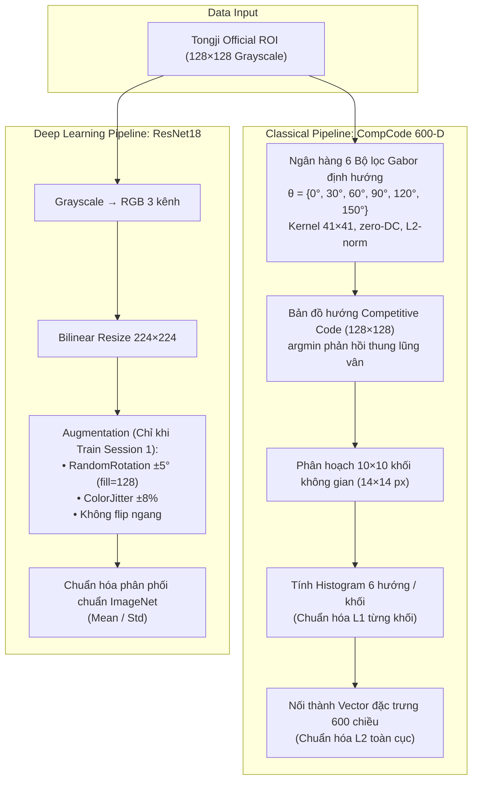

# Tongji Contactless Palmprint Recognition

> **BÀI TẬP LỚN CUỐI KỲ — MÔN NHẬN DẠNG MẪU (PATTERN RECOGNITION)**  
> **Đề tài số 9:** Nhận diện lòng bàn tay không tiếp xúc (*Contactless Palmprint Recognition*)  
> **Nhóm thực hiện:** Nhóm 01  
> **Repository:** [https://github.com/hloc1810/tongji-palmprint-recognition](https://github.com/hloc1810/tongji-palmprint-recognition)

---

## 1. Giới thiệu bài toán

Hệ thống nhận dạng sinh trắc học lòng bàn tay không tiếp xúc (*Contactless Palmprint Identification*) theo giao thức **closed-set 1:N** trên bộ dữ liệu chuẩn **Tongji Contactless Palmprint Dataset**:
- **Đối tượng nhận dạng**: **600 Palm ID** (mỗi bàn tay là một lớp độc lập, tương ứng 300 đối tượng $\times$ 2 bàn tay trái/phải).
- **Giao thức phân chia phiên (Cross-Session Protocol)**:
  - **Session 1 (Gallery / Huấn luyện)**: 6.000 ảnh (10 ảnh/Palm ID $\times$ 600 lớp).
  - **Session 2 (Probe / Kiểm thử)**: 6.000 ảnh (10 ảnh/Palm ID $\times$ 600 lớp), chụp cách Session 1 một khoảng thời gian nhằm mô phỏng thực tế (thay đổi độ sáng, xoay góc tay, biến dạng co giãn cơ).
- **Nguyên tắc chống rò rỉ dữ liệu (No Data Leakage)**:
  - Chọn siêu tham số bằng **5-fold Cross-Validation nội bộ trên Session 1** (`seed=42`).
  - Khóa toàn bộ mô hình và tham số (`protocol_lock.json`) trước khi giải mã đặc trưng Session 2.
  - Không sử dụng dữ liệu Session 2 để chọn tham số hay chọn seed, đảm bảo tính khách quan của thực nghiệm.

---

## 2. Kết quả thực nghiệm chính thức

Thực nghiệm đo đạc độc lập trên **6.000 probe Session 2** đối chiếu với **6.000 gallery Session 1** (sử dụng Official ROI 128×128):

| Pipeline | Mô hình nhận dạng | Rank-1 (%) | Rank-5 (%) | Macro-F1 (%) | Độ trễ CPU (ms/ảnh) |
|---|---|---:|---:|---:|---:|
| **M3** | **CompCode + CRC_RLS** ($\lambda=0.1$, unnormalized residual) | **98.27%** | **99.08%** | **97.99%** | 14.71 ms |
| **M2** | **CompCode + Linear SVM OvR** ($C=1$, squared-hinge) | **97.37%** | **98.52%** | **96.82%** | **3.71 ms** |
| **M1** | **CompCode + 1-NN** ($k=1$, Euclidean²) | **94.43%** | **96.97%** | **93.56%** | 11.00 ms |
| **M4-E2** | **ResNet18 Nearest Cosine** (512-D, 10 template/lớp) | **73.74% ± 0.62** | **87.50% ± 0.44** | **70.51% ± 0.81** | ~19.34 ms |
| **M4-E2** | **ResNet18 Centroid Cosine** (512-D, 1 tâm/lớp) | **68.83% ± 0.76** | **83.70% ± 0.63** | **65.37% ± 0.82** | ~19.34 ms |
| **M4-E1** | **ResNet18 Logits** (Softmax 600 lớp) | **64.36% ± 1.04** | **81.91% ± 0.65** | **60.79% ± 1.10** | ~48.72 ms |

*Ghi chú*: Kết quả ResNet18 là trung bình và độ lệch chuẩn mẫu qua 3 seed độc lập (17, 29, 43). Độ trễ đo trên CPU AMD Ryzen 7 5800H chạy đơn luồng (bao gồm đọc ROI, trích đặc trưng và tính điểm 600 lớp).

### Phân tích khoa học nổi bật:
1. **CRC_RLS (M3) đạt hiệu năng cao nhất (98.27%)**: Nhờ cơ chế biểu diễn cộng tác (*collaborative representation*), toàn bộ 6.000 mẫu trong gallery cùng tham gia tái tạo mẫu truy vấn thông qua hồi quy Ridge có điều chuẩn $L_2$, giúp triệt tiêu sai lệch ánh sáng và góc chụp giữa 2 phiên hiệu quả nhất.
2. **Linear SVM (M2) đạt tốc độ nhanh nhất (3.71 ms/ảnh)**: Trong pha suy luận, SVM One-vs-Rest chỉ thực hiện 1 phép nhân ma trận trọng số $W \in \mathbb{R}^{600 \times 600}$ với vector đặc trưng 600-D, nhanh gấp 4 lần CRC và 13 lần ResNet18 mà vẫn đạt Rank-1 rất cao (97.37%).
3. **Hiệu quả của không gian Cosine Embedding (+9.38% Rank-1)**: Trên tập dữ liệu ít mẫu (10 ảnh/lớp), tầng Softmax 600 lớp gặp hiện tượng quá khớp (overfitting, 64.36%). Khi trích xuất vector đặc trưng 512-D từ tầng áp chót và so khớp bằng khoảng cách Cosine, Rank-1 đạt **73.74%**, cho thấy không gian embedding học được tính tương đồng tốt hơn lớp phân loại cứng.

---

## 3. Quy trình tiền xử lý & Trích xuất đặc trưng



### 3.1. Chuẩn hóa đầu vào (Input Reading)
- Sử dụng trực tiếp ảnh **Official ROI 128×128** (uint8 grayscale, giá trị 0–255).
- **Lý do không dùng bộ lọc làm mờ (Blur) hay nhị phân hóa (Otsu/Threshold)**:
  - Vân lòng bàn tay gồm các đường chỉ chính và nếp nhăn phụ (wrinkles) có tần số không gian rất cao. Blur sẽ làm nhòe và xóa mất nếp vân nhỏ.
  - Nhị phân hóa Otsu/Canny sẽ làm đứt gãy vân và sinh nhiễu nhị phân giả dưới điều kiện chiếu sáng không đều.
  - Cấu hình `zero_dc = True` của bộ lọc Gabor (`kernel -= kernel.mean()`) đã tự động khử toàn bộ độ lệch ánh sáng nền tổng thể.

### 3.2. Nhánh Cổ điển — Competitive Code (CompCode)
Triển khai trong `src/palmprint/features/compcode.py`:
1. **6 Bộ lọc Gabor định hướng**:
   $$G_{\theta}(x, y) = \exp\left(-\frac{1}{2}\left(\frac{x_r^2}{\sigma_x^2} + \frac{y_r^2}{\sigma_y^2}\right)\right) \cos(2\pi f x_r)$$
   với $\sigma_x = 4.85, \sigma_y = 9.31, f = 0.071$, kernel $41 \times 41$, border mode `reflect101`.
2. **Competitive Coding**: Tìm hướng cho phản hồi thung lũng vân sâu nhất:
   $$\text{CompCode}(x, y) = \arg\min_{j \in \{0..5\}} (I * G_{\theta_j})(x, y)$$
3. **Histogram 100 khối không gian**: Chia ảnh thành lưới $10 \times 10$ khối ($14 \times 14$ px/khối) $\implies$ đếm 6 bin hướng cho mỗi khối $\implies$ vector $100 \times 6 = \mathbf{600\text{ chiều}}$.
4. **Chuẩn hóa 2 cấp**: Chuẩn hóa $L_1$ theo từng khối (bất biến mật độ vân cục bộ) $\to$ Chuẩn hóa $L_2$ toàn vector (đưa về mặt cầu đơn vị).

### 3.3. Nhánh Deep Learning — ResNet18
Triển khai trong `src/palmprint/models/resnet.py`:
- Nhân bản 1 kênh xám thành 3 kênh RGB giống nhau.
- Resize từ $128 \times 128 \to 224 \times 224$ (kích thước chuẩn ImageNet) bằng nội suy song tuyến (Bilinear).
- Data Augmentation (chỉ kích hoạt lúc train): `RandomRotation(±5°)`, `ColorJitter(±8%)`. **Không dùng flip ngang** vì bàn tay trái/phải mang tính bất đối xứng giải phẫu học.
- Chuẩn hóa ImageNet: Trừ mean `[0.485, 0.456, 0.406]`, chia std `[0.229, 0.224, 0.225]`.

---

## 4. Các mô hình nhận dạng & Cơ sở toán học

### M1 — 1-Nearest Neighbor (1-NN Baseline)
- *Cơ sở lý thuyết*: R. O. Duda, P. E. Hart, D. G. Stork, *Pattern Classification*, 2nd ed., Chương 4.
- *Quy tắc quyết định*: Đo khoảng cách Euclidean bình phương giữa vector truy vấn $y$ và các template trong gallery của lớp $c$:
  $$\text{score}_c(y) = \min_{j: \text{label}_j = c} \|y - v_j\|_2^2$$

### M2 — Linear Support Vector Machine (Linear SVM OvR)
- *Cơ sở lý thuyết*: Duda et al., Chương 5.
- *Mô hình*: `LinearSVC` cấu hình multi-class One-vs-Rest, $C=1$, $L_2$ penalty, squared-hinge loss có bias ($b_c$):
  $$\min_{w_c, b_c} \frac{1}{2}(\|w_c\|_2^2 + b_c^2) + C \sum_{i} \max(0, 1 - t_{ic}(w_c^T x_i + b_c))^2$$
- Điểm đánh giá: $\text{score}_c(x) = -(w_c^T x + b_c)$ (điểm càng thấp càng xếp hạng cao).

### M3 — Collaborative Representation Classifier (CRC_RLS)
- *Cơ sở lý thuyết*: Zhang et al., *Pattern Recognition* 69 (2017), §5, Eq. (4)–(6).
- *Nguyên lý*: Biểu diễn mẫu truy vấn $y$ dưới dạng tổ hợp tuyến tính của **toàn bộ từ điển gallery $A \in \mathbb{R}^{m \times n}$** qua bài toán hồi quy Ridge:
  $$x^* = \arg\min_x \|y - Ax\|_2^2 + \lambda \|x\|_2^2 \implies x^* = (A^T A + \lambda I)^{-1} A^T y$$
- *Triển khai tối ưu*: Giải hệ tuyến tính bằng phân rã Cholesky một lần duy nhất lúc fit ($\lambda = 0.1$).
- *Sai số tái tạo (Residual)*: $\text{score}_c(y) = \|y - A_c x_c^*\|_2$ (không chia cho chuẩn hệ số lớp để giữ tính toàn vẹn thứ hạng).

### M4 — ResNet18 & Cosine Embedding Matching
- *Cơ sở lý thuyết*: Duda et al., Chương 6; Deep Metric Learning.
- *Kiến trúc*: Pretrained ImageNet ResNet18, thay head phân loại 600 lớp, fine-tune Layer 4.
- *Chiến lược trích xuất Embedding*:
  - Lấy vector đặc trưng 512-D từ tầng áp chót (AvgPool) $\to$ Chuẩn hóa $L_2$.
  - **Nearest Cosine**: Đo khoảng cách cosin nhỏ nhất tới 10 mẫu gallery của từng Palm ID:
    $$\text{score}_c(y) = -\max_{g \in \text{Gallery}_c} \frac{e_y \cdot e_g}{\|e_y\|_2 \|e_g\|_2}$$
  - **Centroid Cosine**: Tính tâm đại diện $\mu_c$ cho mỗi Palm ID từ 10 mẫu gallery đã chuẩn hóa, sau đó đo khoảng cách cosin tới 600 tâm đại diện.

---

## 5. Cài đặt & Hướng dẫn sử dụng

### 5.1. Yêu cầu môi trường
- Python **3.11** hoặc **3.12** (khuyến nghị 64-bit trên Windows).
- Cài đặt package ở chế độ editable:
  ```powershell
  python -m pip install -e ".[test,demo,cnn]"
  ```

### 5.2. Chạy ứng dụng Web Demo (Streamlit)
```powershell
streamlit run app/main.py
```
> Giao diện cho phép chọn trực tiếp ảnh từ tập Session 2 hoặc tải ảnh ROI 128×128 lên, lựa chọn thuật toán (KNN, SVM, CRC, ResNet18) và tự động đối chiếu với mẫu đăng ký tương ứng trong Session 1.

### 5.3. Nhận dạng ảnh qua dòng lệnh (CLI)
- **Mô hình Cổ điển (CRC / SVM / KNN)**:
  ```powershell
  palmprint predict --model crc --image data/raw/session2/00001.bmp
  palmprint predict --model svm --image data/raw/session2/00001.bmp
  palmprint predict --model knn --image data/raw/session2/00001.bmp
  ```
- **Mô hình Deep Learning (ResNet18 Nearest Cosine)**:
  ```powershell
  palmprint-cnn embedding-predict --seed 17 --strategy nearest --image data/raw/session2/00001.bmp --device cpu
  ```

### 5.4. Chạy kiểm thử tự động
Toàn bộ hệ thống được bảo vệ bởi 58 ca kiểm thử đơn vị và tích hợp:
```powershell
python -m pytest -q
python scripts/run_smoke.py
```

---

## 6. Cấu trúc mã nguồn

```text
.
├── app/
│   └── main.py                     # Ứng dụng Web Demo Streamlit
├── artifacts/                      # Trọng số mô hình và gallery đã huấn luyện
│   ├── crc.joblib, knn.joblib, svm.joblib
│   ├── resnet18_seed{17,29,43}.pth
│   └── resnet18_seed{17,29,43}_gallery512.npz
├── configs/                        # Cấu hình siêu tham số (compcode.yaml, resnet18.yaml)
├── data/
│   ├── metadata/                   # Manifest, audit và hash toàn vẹn
│   └── raw/                        # 12.000 ảnh ROI (session1: 6.000 ảnh, session2: 6.000 ảnh)
├── reports/
│   ├── figures/                    # Biểu đồ CMC, ma trận nhầm lẫn
│   ├── tables/                     # Bảng kết quả benchmark CSV chi tiết
│   ├── CNN_EXPERIMENTS.md          # Chi tiết thực nghiệm CNN 3 seed
│   └── TONGJI_BENCHMARK.md         # Báo cáo benchmark đầy đủ
├── src/palmprint/
│   ├── cli.py, cli_cnn.py          # Entrypoint giao diện dòng lệnh
│   ├── data/                       # Đọc ảnh ROI, split fold, manifest
│   ├── features/                   # Trích xuất CompCode Gabor 600-D
│   ├── models/                     # KNN, SVM, CRC_RLS, ResNet18 runtime
│   ├── training/                   # 5-fold CV, refit, protocol lock
│   ├── evaluation/                 # Metrics Rank-k, Macro-F1, Cosine matching
│   └── reporting/                  # Báo cáo bằng chứng thực nghiệm
├── tests/                          # Bộ test tự động (58 passed, 100%)
├── pyproject.toml                  # Khai báo package và dependencies
└── README.md                       # Tài liệu chính của dự án
```

---

## 7. Tài liệu tham khảo

1. **Bài báo gốc bộ dữ liệu Tongji**:
   - L. Zhang, L. Li, A. Shen, M. Hermessi, and F. Wu, *"Towards contactless palmprint recognition: A novel device, a new benchmark, and a collaborative representation based identification approach"*, **Pattern Recognition**, vol. 69, pp. 199–212, 2017. [Link paper](https://cslinzhang.github.io/ContactlessPalm/contactlesspalm.pdf) · [Trang tác giả](https://cslinzhang.github.io/ContactlessPalm/).
2. **Giáo trình môn học**:
   - R. O. Duda, P. E. Hart, and D. G. Stork, *"Pattern Classification"*, 2nd ed., John Wiley & Sons, 2001.
3. **Competitive Code gốc**:
   - A. Kong and D. Zhang, *"Competitive coding scheme for palmprint verification"*, **ICPR**, 2004.
4. **ResNet & Deep Learning**:
   - K. He, X. Zhang, S. Ren, and J. Sun, *"Deep residual learning for image recognition"*, **CVPR**, 2016.
