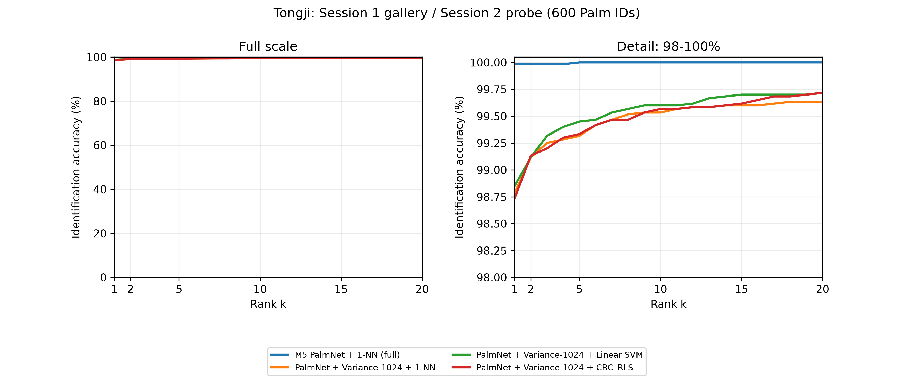

# M5 — PCA-Gabor PalmNet trên Tongji

## Phạm vi và nguồn

M5 dùng nhánh **PCA → Gabor** trong Python port do tác giả cung cấp. Đây là
**PCA-Gabor PalmNet**, không khẳng định tái lập chính xác mọi biến thể
PalmNet-GaborPCA của bài báo. Bộ lọc được học không giám sát; không dùng
backpropagation, Cross-Entropy hay nhãn Palm ID để fit bộ trích xuất.

- [Bài báo PalmNet, Genovese và cộng sự, IEEE TIFS 2019](https://air.unimi.it/handle/2434/637849)
- [Trang dự án của tác giả](https://iebil.di.unimi.it/palmnet/)
- [Mã nguồn tại commit dùng cho thực nghiệm](https://github.com/AngeloUNIMI/PalmNet/tree/f0a12e6d5f585c7eb0bf5c6804a98bd1d6587e22)
- [Cấu hình tham chiếu và kế hoạch classifier](../configs/palmnet_m5.json)
- [Adapter trong dự án](../src/palmprint/training/palmnet.py)
- [Chọn đặc trưng sparse](../src/palmprint/features/palmnet.py)

Mã nguồn tác giả được tải riêng trong `.runtime/PalmNet`, giữ nguyên giấy phép
GPL-3.0 của nguồn đó. Adapter ghi commit, SHA-256 của từng file Python của bộ
trích xuất, model, gallery, manifest và thứ tự sample UID.

[Checkpoint bộ trích xuất PCA-Gabor đã fit trên Session 1](../artifacts/pretrained/palmnet_pca_gabor_session1.pt)
được lưu kèm repository (SHA-256 `a2362e89ed7a0ca829df0c90d45328367fc48df6ec26ce9c106f6bdcf4ff5b05`).
Checkpoint chứa các bộ lọc và metadata học, có thể nạp qua `PalmPCAGabor.load`
sau khi cài Python port. Để nhận dạng 600 Palm ID vẫn cần tạo gallery từ
Session 1; checkpoint bộ trích xuất không chứa gallery hay classifier đã fit.

## Pipeline và giao thức

| Thành phần | Cấu hình |
|---|---|
| Input | Official ROI 128 × 128, grayscale uint8; kiểm tra bằng decoder của dự án |
| Tiền xử lý | Trừ trung bình từng ảnh theo Python port; không CLAHE bổ sung |
| Stage 1 | PCA trên patch valid 15 × 15, trừ trung bình mỗi patch; 15 bộ lọc |
| Stage 2 | 10 Gabor cố định + 5 wavelet chọn từ ngân hàng đa tỉ lệ |
| Hướng thích nghi | 10 ứng viên học từ ảnh Session 1 gốc đã tiền xử lý |
| Stage 3 | Dấu phản hồi (`> 0`), 15 bit cho từng nhánh PCA |
| Stage 4 | Histogram 23 × 23, overlap 0, 25 block, chuẩn hóa `matlab` của port |
| Descriptor | CSR sparse, `15 × 25 × 2^15 = 12.288.000` chiều |
| Học bộ lọc | Toàn bộ 6.000 ảnh Session 1; mọi patch, không lấy mẫu gần đúng |
| Gallery | 6.000 ảnh Session 1; 600 Palm ID × 10 template |
| Probe | 6.000 ảnh Session 2 sau khi model/gallery được đóng băng |
| Điểm lớp | Khoảng cách Euclidean bình phương nhỏ nhất đến 10 template của lớp |
| Đánh giá | Rank-1, Rank-5, Macro-F1, CMC; CI95% bootstrap theo Palm ID |

Với mỗi probe q và Palm ID c:

`D(q,c) = min_{g thuộc gallery của c} ||f(q) - f(g)||²`.

Xếp hạng trên **600 điểm lớp**, không lấy 5 template gần nhất làm Rank-5.
Euclidean bình phương có cùng thứ tự xếp hạng với Euclidean. Khi bằng điểm,
`ranking()` hiện có ưu tiên Palm ID nhỏ hơn theo stable sort.

Port chia 128 × 128 thành lưới 5 × 5 block hoàn chỉnh: phần biên dư 13 pixel
bên phải/dưới không tạo block mới. Histogram chuẩn hóa theo port có tổng mỗi
block bằng `2^15`; M5 chính không bổ sung chuẩn hóa L2 toàn vector.

## Bộ nhớ và khả năng tiếp tục

Mỗi shard trích xuất tối đa 64 ảnh. Không densify toàn bộ descriptor và không ghép
toàn bộ gallery/probe bằng `sparse.vstack`. CSR cuối được ghi vào file nhị phân
và đọc bằng memory mapping. Matching chỉ densify ma trận khoảng cách nhỏ theo
khối; kết quả cuối là 6.000 × 600 điểm.

Backend `hybrid` tách 65.536 cột phổ biến trong gallery để nhân dense theo
khối; mọi cột còn lại vẫn được nhân sparse. Hai tích vô hướng được cộng lại,
giữ nguyên khoảng cách Euclidean trên đủ 12.288.000 chiều. Đây là tối ưu tính
toán, không phải giảm chiều hoặc lọc ứng viên. Backend sparse song song dùng
`sp_matmul` đầy đủ, không top-k hay ngưỡng similarity. Có thể dùng
`evaluate --matcher scipy` để chạy cách tính CSR thông thường.

`train` lưu model ngay sau fit và cache từng shard kèm hash. Có thể chạy lại
cùng lệnh nếu trích xuất bị gián đoạn; model/config/manifest/order phải trùng.
Sau `freeze.json`, không ghi đè gallery/model; `evaluate` từ chối ghi đè kết quả
đã hoàn thành. Cache bị sửa bị từ chối. Timing khi tiếp tục từ cache không phải
thời gian trích xuất từ đầu.

## Linear SVM và CRC_RLS

Hai nhánh mở rộng dùng cùng một phép **chọn 1.024 cột có phương sai lớn nhất
trên Session 1**, sau đó chuẩn hóa L2. Chỉ ma trận đã chọn 1.024 chiều được
chuyển dense. Không fit ma trận covariance 12.288.000 × 12.288.000 và không
đưa descriptor gốc vào CRC_RLS.

Kế hoạch cố định trước Session 2: LinearSVC `C=1`, CRC_RLS `lambda=0.1`;
không tuyên bố đây là hyperparameter tối ưu. Chạy thêm **1-NN trên cùng 1.024
chiều** làm đối chứng. So sánh SVM/CRC với đối chứng này mới tách được ảnh hưởng
của classifier khỏi ảnh hưởng của giảm số đặc trưng.

Lựa chọn cấu hình khác hoặc tối ưu hyperparameter sau này phải dùng validation
trên Session 1. Mỗi fold validation cần fit lại cả PalmNet và bộ chọn đặc trưng
trên phần train của fold. Không dùng kết quả Session 2 để chọn số bộ lọc,
histogram block, số chiều, C, lambda hay distance metric.

## Cách chạy

Từ thư mục gốc dự án, dùng Python có các dependency dự án và PyTorch:

```powershell
python -m pip install -e ".[palmnet,test]"
git clone https://github.com/AngeloUNIMI/PalmNet.git .runtime/PalmNet
git -C .runtime/PalmNet checkout f0a12e6d5f585c7eb0bf5c6804a98bd1d6587e22
python scripts/run_palmnet_m5.py self-test
python scripts/run_palmnet_m5.py train --pca-image-batch 1 --orientation-batch 4 --gabor-tuning-batch 1
python scripts/run_palmnet_m5.py train-classifiers
python scripts/run_palmnet_m5.py evaluate --gallery-batch 256 --matcher hybrid
python scripts/run_palmnet_m5.py evaluate-classifiers
python scripts/summarize_palmnet_m5.py
```

`scripts/run_palmnet_m5.py` gọi module `palmprint.training.palmnet`. Có thể
chạy `palmprint-palmnet` sau khi cài package. `--data-root` và
`--palmnet-python` đặt **trước** subcommand nếu cần thay đường dẫn. Mặc định
dùng `data/raw` trong workspace, tránh đường dẫn máy cũ trong local metadata.

`train-classifiers` bắt buộc chạy trước khi trích xuất Session 2.
`evaluate-classifiers` chạy sau khi benchmark 1-NN chính hoàn thành. Nếu chỉ
cần M5 chính, bỏ qua hai lệnh classifier.

## Kết quả thực nghiệm ngày 03/11/2026

Đã hoàn tất trên đủ 6.000 probe Session 2, dùng 6.000 gallery Session 1 và 600
Palm ID. Tất cả SHA-256 ảnh được kiểm tra; fit dùng toàn bộ patch, không lấy
mẫu gần đúng. Model và cả ba classifier mở rộng đã đóng băng trước khi đọc ROI
Session 2. Nguồn và cấu hình thực tế nằm trong
[protocol.json](../outputs/palmnet_m5/protocol.json).
Sau benchmark, mã dự án được định dạng theo Ruff để tương thích CI; hash mã
chạy thực nghiệm và hash mã công bố được ghi riêng trong protocol. Cây cú pháp
trước và sau định dạng đã được đối chiếu tương đương.

| Phương pháp | Số chiều | Rank-1 (%) | Rank-5 (%) | Macro-F1 (%) |
|---|---:|---:|---:|---:|
| **M5 — PCA-Gabor PalmNet + 1-NN** | **12.288.000** | **99,9833** | **100,0000** | **99,9833** |
| PalmNet + chọn phương sai + 1-NN, đối chứng | 1.024 | 98,7833 | 99,3167 | 98,6097 |
| PalmNet + chọn phương sai + Linear SVM | 1.024 | 98,8500 | 99,4500 | 98,6943 |
| PalmNet + chọn phương sai + CRC_RLS | 1.024 | 98,7333 | 99,3333 | 98,5820 |

M5 chính đúng **5.999/6.000** probe. CI95% Rank-1 bootstrap theo Palm ID
(`B=1.000`, seed=42): **[99,95%; 100%]**. Probe sai duy nhất là
`session2/00273`: Palm ID thật 28, dự đoán 170; ID 28 đứng thứ 5.



### Hiệu quả đặc trưng và classifier

Nhánh chọn 1.024 cột rồi chuẩn hóa L2 có Rank-1 của 1-NN thấp hơn **1,20 điểm
phần trăm** so với descriptor đầy đủ không chuẩn hóa L2 toàn vector. Bootstrap
cặp đôi theo Palm ID (`B=10.000`, seed=42) cho chênh lệch
full 1-NN trừ selected 1-NN có CI95% **[+0,65; +1,8667] điểm phần trăm**.
Biểu diễn rút gọn và chuẩn hóa hiện tại không duy trì được mức chính xác của
descriptor đầy đủ. So sánh này đồng thời thay đổi số cột và chuẩn hóa, nên chưa
tách được riêng tác động của từng bước.

Trên cùng 1.024 chiều, SVM hơn 1-NN **0,0667 điểm phần trăm** (thêm 4 probe
đúng), CI95% **[-0,20; +0,30]**; CRC_RLS kém 1-NN **0,05 điểm phần trăm**,
CI95% **[-0,3833; +0,2667]**. Các khoảng này chứa 0, nên chưa có bằng chứng
để kết luận hai classifier vượt trội 1-NN. Đây là so sánh các cấu hình cố định,
không phải kết quả tìm hyperparameter tối ưu.

### Chi phí tính toán

Máy chạy CPU, PyTorch 2.4.1, float64, 4 thread; không dùng CUDA.

| Công đoạn | Thời gian (giây) |
|---|---:|
| Fit PCA và chọn Gabor trên Session 1 | 303,03 |
| Trích xuất và lưu 6.000 gallery | 710,38 |
| Trích xuất và lưu 6.000 probe | 667,28 |
| Matching đầy đủ M5 | 889,91 |
| Matching selected 1-NN / SVM / CRC_RLS | 1,808 / 0,156 / 5,065 |

Gallery có 541.396.929 phần tử khác 0, khoảng **6,05 GiB** CSR float64/int32
trên đĩa; probe có 541.799.361 phần tử khác 0. Chi phí lưu trữ và đối sánh
descriptor đầy đủ là hạn chế thực tế, dù độ chính xác cao. Giảm chiều giúp
matching nhanh hơn nhưng vẫn cần bộ trích xuất PalmNet phía trước.

### Kiểm tra kết quả

- **27 kiểm thử dự án liên quan + 51 kiểm thử số học upstream đều qua**.
- Metrics được tính lại từ toàn bộ ma trận điểm; kiểm tra hash, thứ tự sample
  UID và nhãn trên đủ 6.000 probe cho cả bốn phương pháp.
- Matcher CSR gốc được chạy lại trên 4 probe, gồm ca sai duy nhất: so đủ 600
  khoảng cách lớp, top-5 trùng nhau; sai số float64 tuyệt đối lớn nhất khoảng
  0,00219 trên các khoảng cách có độ lớn hàng tỷ.
- [Bảng kết quả CSV](../outputs/palmnet_m5/summary.csv),
  [bootstrap cặp đôi](../outputs/palmnet_m5/paired_comparisons.json),
  [kiểm tra khoảng cách](../outputs/palmnet_m5/distance_audit.json),
  [dự đoán M5 từng probe](../outputs/palmnet_m5/nearest_template/predictions.csv).

Đo tài nguyên sơ bộ chỉ dùng 12 ảnh Session 1: descriptor đúng 12.288.000 chiều,
khoảng 88.458 phần tử khác 0/ảnh. Đây không phải kết quả nhận dạng Tongji.

Lần đầu PyTorch 2.15.0 CPU gặp lỗi cấp phát bộ nhớ trong PCA ở khoảng ảnh
2.900/6.000. Lần chạy tiếp theo dùng PyTorch 2.4.1 CPU, khối PCA 1 ảnh,
orientation 4 ảnh và Gabor tuning 1 ảnh; vẫn float64, toàn bộ patch và 15 bộ lọc.

Kết quả và bằng chứng nằm trong `outputs/palmnet_m5/<method>/`:
`metrics.json`, `predictions.csv`, `scores.npz`, `cmc.csv`. GitHub lưu metrics,
dự đoán, CMC và checkpoint bộ trích xuất; ma trận điểm `scores.npz`, model
classifier/freeze và cache lớn được giữ cục bộ, vì vậy cần chạy lại thí nghiệm
để tái tạo các tệp này trên máy mới.
Mã nguồn PalmNet gốc cũng được tải riêng theo commit ghi ở trên.

Latency của script là thời gian theo batch, bao gồm IO cache. Không so trực tiếp
với single-query CPU latency trong bảng benchmark M1–M4 hiện có.
